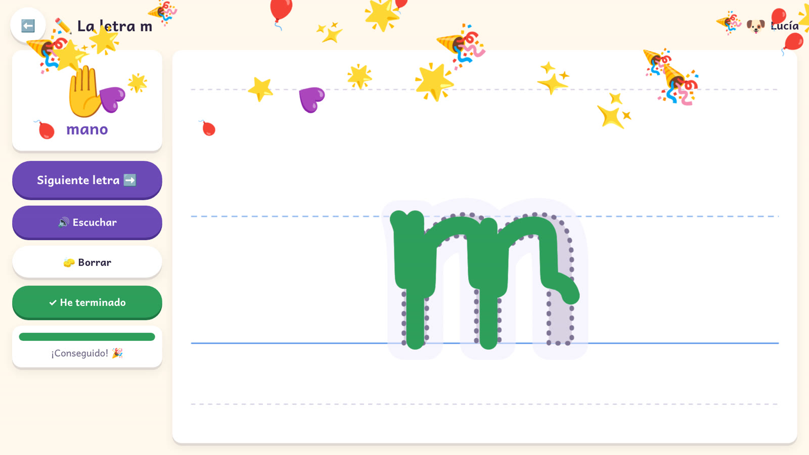
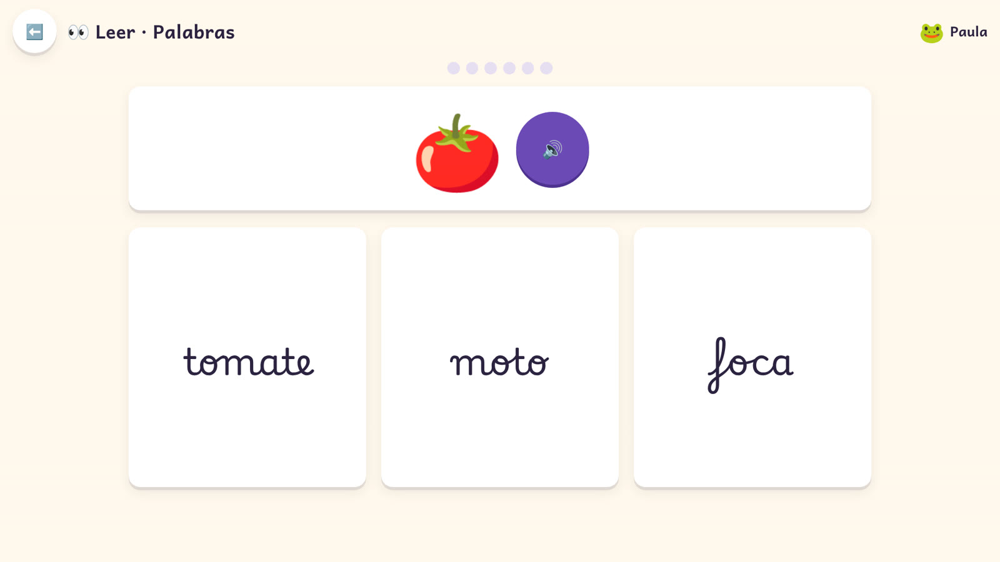
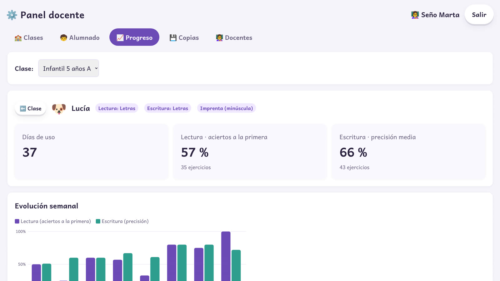

# Lectoescritura

Aplicación de lectoescritura para **pizarra digital táctil** (Guadalinex), que también funciona en **PC con Windows** y **tablets Android**.

Pensada para Infantil, Primaria y alumnado con necesidades específicas: cada alumno tiene su propio nivel **por áreas** (lectura y escritura), su **tipo de letra** y sus **ayudas**.



| Leer palabras (cursiva) | Progreso del alumno |
|---|---|
|  |  |

## Qué incluye (versión 0.2)

**Alumnado**
- Entrada sin saber leer: el alumno toca su clase y después su animal.
- **Leer**, en 4 niveles con actividades que se alternan:
  1. Letras: escucha y toca la letra.
  2. Sílabas: escucha y toca la sílaba, o completa la sílaba que falta.
  3. Palabras: elige la palabra del dibujo, forma la palabra con sílabas o completa la letra que falta.
  4. Frases: lee y toca el dibujo, u ordena la frase.
- **Escribir**, en 3 niveles: trazado de letras (abecedario con estrellas), sílabas y palabras, y dictado con letras móviles.
- **Trazado con orden y dirección** (imprenta y mayúsculas): punto verde de inicio, flecha, número de trazo y modelo animado («Ver cómo se hace»). Avisa si se empieza al revés o se sale del camino.
- **Cursiva ligada**: se comprueba que se repasa toda la letra, zona por zona.
- Voz en español, o la **voz grabada por el docente** si la hay.

**Tipos de letra:** imprenta minúscula, mayúsculas y cursiva ligada escolar (Playwrite España).

**Ayudas por alumno:** modo sensible, botones grandes, voz lenta, apoyo con dibujos, exigencia del trazado y letras trabajadas.

**Estilo visual**
- Normal: colores suaves, iconos sencillos y pequeñas celebraciones.
- **Modo sensible** (para todo el equipo o para un alumno): colores apagados, sin sombras, sin adornos y sin animaciones.
- Celebración configurable: estrellas, solo ✓ o nada. Voz de ánimo activable.

**Docentes**
- Cuentas con PIN. Clases compartidas entre docentes (tutora + PT + AL).
- Alta rápida pegando una lista de nombres.
- **Audios**: grabar la propia voz para letras, sílabas, palabras, frases y ánimos.
- **Dibujos**: emojis o pictogramas de ARASAAC (se descargan una vez y funcionan sin conexión). Cada dibujo se puede cambiar por una imagen propia.
- Progreso: resumen de la clase, evolución semanal, mapa por letras y lo que más cuesta.
- **Informe imprimible por alumno** (o en PDF), con observaciones del docente.
- **Bloqueo del aula**: clase fija en el equipo; cambiar de clase, el modo demostración y cerrar la app (versión de escritorio) piden PIN.
- Copias de seguridad en archivo (con o sin audios), recordatorio cada 14 días y, en la versión de escritorio, **copia automática diaria** en `Documentos/Lectoescritura/copias`.

Los datos se guardan **solo en el equipo** donde se usa la app. Solo se conecta a internet si el docente pide descargar los pictogramas.

## Cómo usarla

### En la pizarra (Guadalinex)
1. En la pestaña **Releases** de este repositorio, descarga el archivo `.deb`.
2. Instálalo con doble clic (o con `sudo dpkg -i lectoescritura_*.deb`).
3. Aparecerá **Lectoescritura** en el menú de aplicaciones y se abrirá a pantalla completa. `F11` sale de la pantalla completa y `Ctrl+Q` cierra la app.

Si no puedes instalar paquetes, copia la carpeta `app` al equipo y abre `index.html` con Firefox o Chromium.

### En tablet Android o PC
Abre la web publicada: `https://jurjurjur87-wq.github.io/lectoescritura/`

- **Tablet:** en Chrome, menú ⋮ → **Añadir a pantalla de inicio**. Después funciona sin conexión.
- **Windows:** usa la web o descarga el instalador `.exe` desde **Releases**.

El progreso de cada dispositivo es independiente. Para juntarlo, usa **Panel docente → Copias**.

### Voz
La app usa la voz del sistema. En Guadalinex puede hacer falta instalar una voz en español, por ejemplo:

```
sudo apt install speech-dispatcher espeak-ng
```

## Cómo se publica

- **Web:** cada cambio subido a `main` se publica solo en GitHub Pages (`.github/workflows/pages.yml`). Hay que activarlo una vez en *Settings → Pages → Source: GitHub Actions*.
- **Paquetes:** al crear una etiqueta de versión (por ejemplo, `v0.1.0`), GitHub Actions genera el `.deb`, el `AppImage` y el instalador de Windows, y los deja en **Releases** (`.github/workflows/release.yml`).

```
git tag v0.1.0
git push origin v0.1.0
```

## Estructura

```
app/            La aplicación web (todo lo que ve el alumno y el docente)
  index.html    Página principal
  css/          Estilos (normal y modo sensible)
  js/           contenidos.js (letras, palabras, frases), trazos.js (forma y orden
                de cada letra), medios.js (audios, pictogramas, iconos), app.js
  fonts/        Fuentes escolares (licencia SIL OFL)
  sw.js         Uso sin conexión en tablet / web
electron/       Envoltorio de escritorio para Guadalinex y Windows
build/          Icono para los paquetes
```

## Ideas para próximas versiones
- Orden de trazos también en cursiva ligada.
- Más palabras y frases, editables por el docente.

## Licencias
- Aplicación: [CC BY-NC-ND 4.0](https://creativecommons.org/licenses/by-nc-nd/4.0/deed.es). Se puede usar y compartir citando al autor, sin fines comerciales y sin distribuir versiones modificadas.
- Fuentes Andika y Playwrite España: SIL Open Font License 1.1.
- Pictogramas (si se descargan): Sergio Palao. Origen: ARASAAC (https://arasaac.org). Licencia: CC BY-NC-SA. Propiedad: Gobierno de Aragón (España).
