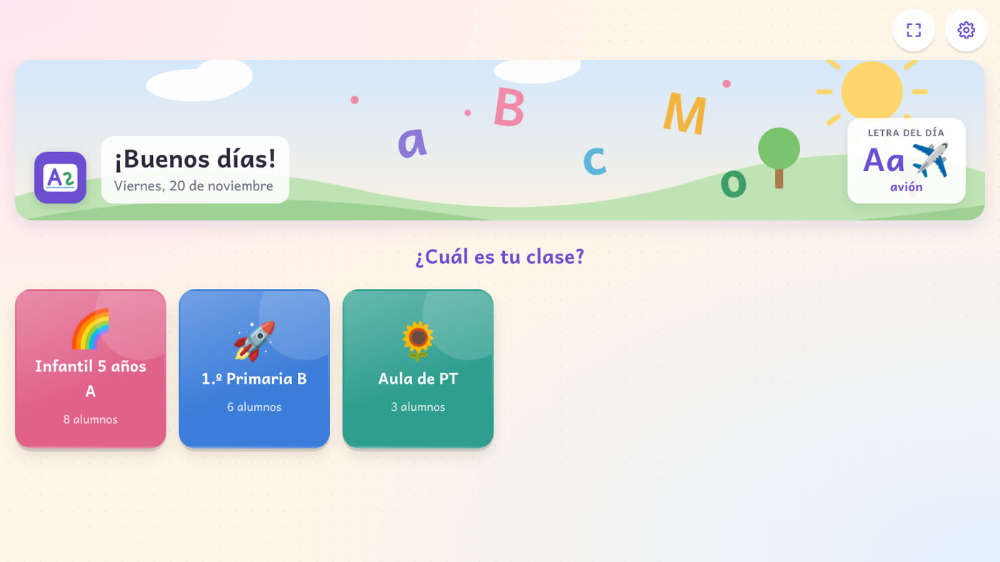
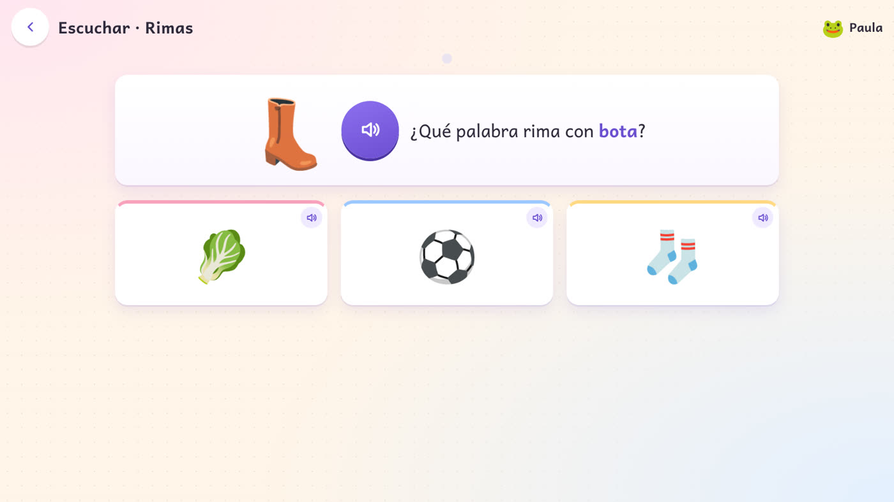
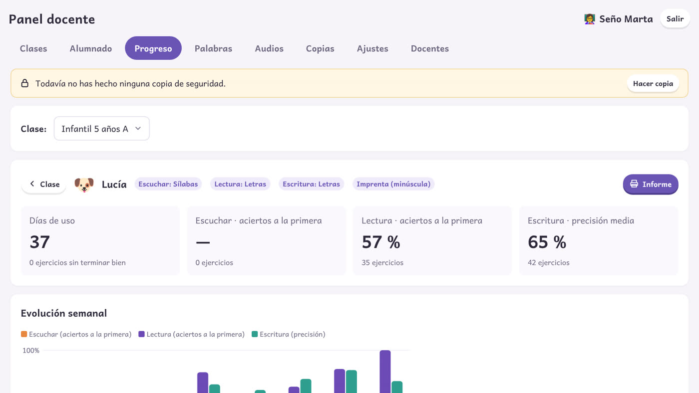

# Lectoescritura

Aplicación de lectoescritura y conciencia fonológica para **pizarra digital táctil** (Guadalinex), **tablets Android**, **móviles** y **PC**. Funciona en el navegador, sin instalar nada y sin conexión una vez abierta.

Pensada para Infantil, Primaria y alumnado con necesidades específicas: cada alumno tiene su propio nivel **por áreas** (escuchar, leer y escribir), su **tipo de letra** y sus **ayudas**.

**Abrir la app:** https://jurjurjur87-wq.github.io/Lectoescritura/



| Trazado con modelo animado | Conciencia fonológica | Progreso del alumno |
|---|---|---|
|  |  |  |

## Qué incluye (versión 0.3)

### Para el alumnado
El alumno entra sin saber leer: toca su clase y después su animal. Tiene tres áreas. Al entrar en cada una aparece **todo el catálogo de actividades**, cada una con su nombre y una pestaña con su nivel (sílabas, sonidos, palabras…). Las del nivel del alumno salen marcadas con una estrella, pero puede abrir cualquiera.

En todos los juegos, tocar una opción solo la marca (si es un dibujo, además lo dice en voz alta); la respuesta se da con **Comprobar**, así no se responde por error. Tras dos fallos, la app quita opciones incorrectas como ayuda (cuenta como un intento). El número de ejercicios por ronda (4, 6 u 8) se elige para cada alumno.

**Escuchar** (conciencia fonológica y comprensión oral)
1. **Sílabas**: ¿cuántas palmadas?, la palabra más larga, ¿cuál es más corta?, une las sílabas, cuenta las palabras de una frase.
2. **Sonidos**: ¿dónde suena «ma»?, ¿cómo empieza?, ¿cómo termina?, la intrusa, ¿suena igual?
3. **Comprensión**: escucha una frase y elige la escena.
4. **Escenas**: escucha y monta la escena con dibujos.
5. **Juegos de sonidos**: rimas, quita una sílaba, añade una sílaba, da la vuelta, encadenadas.

**Leer**
1. **Letras**: escucha y toca la letra.
2. **Sílabas**: escucha y toca la sílaba; completa la sílaba que falta.
3. **Palabras**: elige la palabra del dibujo; forma la palabra con sílabas; completa la letra que falta; une palabra y dibujo; la tarjeta equivocada.
4. **Frases**: lee y toca el dibujo; ordena la frase; **las tijeras** (separa las palabras de una frase); ¿verdad o mentira? (más de 440 frases).

**Escribir**
1. **Letras**: abecedario con estrellas y trazado letra a letra; **trazos de preescritura** (palos, caminos, toboganes, montañas, olas, castillo, puentes, cunas, bucles, ruedas, caracol y muelles); copia la letra; escribe la letra que oyes; ¿con qué letra empieza?
2. **Sílabas**: repasa; dictado con letras móviles; copia la sílaba; escribe la sílaba que oyes; completa la palabra con la sílaba que falta.
3. **Palabras**: repasa; dictado con letras móviles; copia la palabra (sin modelo punteado); completa la palabra; escribe la palabra que oyes; escribe lo que ves (solo el dibujo); ordena las letras.
4. **Frases** (unas 150 frases cortas): repasa la frase; copia la frase; dictado de frases con palabras móviles; completa la frase.

### Trazado trazo a trazo
- En **imprenta**, **mayúsculas** y **letra escolar enlazada**, cada letra tiene su punto de inicio, flecha de dirección, número de trazo y **modelo animado** («Ver cómo se hace»).
- La app avisa si se empieza en otro sitio, al revés o si se sale del camino.
- La **letra escolar** (solo minúsculas, con rabito de entrada) se usa en toda la app: tarjetas, opciones, palabras y frases, que van enteras en minúscula. Las palabras se escriben enlazadas, y los puntos, tildes y rayas se hacen al final.

### Contenidos
- Banco de **casi 400 palabras** con sílabas y dibujo, **unas 185 frases** y **más de 750 escenas**. Las actividades se generan al azar y la app recuerda lo que le ha salido **a cada alumno** (también entre sesiones) para no repetírselo enseguida.
- **Palabras y frases propias** del docente (nombres del alumnado, vocabulario del tema…), con separación en sílabas automática y foto opcional.
- **Pictogramas de ARASAAC**: se descargan una vez y se usan solos en todas las actividades. Si falta alguno, se usa el emoji. Cada dibujo se puede cambiar eligiendo otro pictograma o una foto propia.
- **Audios grabados por el docente** para letras, sílabas, palabras, frases, ánimos y **enunciados** (se graban por trozos, por ejemplo «¿Qué palabra empieza por…», y la app añade la sílaba o palabra). Si no hay grabación, se usa la voz del equipo.

### Estilo visual y ayudas
- Tres aspectos: **Plus** (más colorido, por defecto), **Básico** y **Sensible** (sobrio: colores apagados, sin adornos ni animaciones).
- Ayudas por alumno: modo sensible, botones grandes, voz lenta, apoyo con dibujos, exigencia del trazado y letras trabajadas.
- Celebración configurable (estrellas, solo ✓ o nada) y voz de ánimo activable.

### Para el docente
- Cuentas con PIN. Puede haber **varios administradores** (siempre al menos uno); la administración se puede transferir.
- Clases compartidas entre docentes (tutora + PT + AL). Alta rápida pegando una lista de nombres.
- **Alumnado en varias clases**: un alumno puede estar en su clase y también en PT (o trasladarse de clase). Cada clase puede añadir alumnos de otras sin quitárselos. Es el mismo alumno, pero **cada clase puede ponerle sus propios niveles y tipo de letra** (las ayudas y las letras trabajadas son comunes), y **cada docente, también la administración, solo ve el progreso hecho en las clases en las que da clase**.
- **Progreso**: resumen de la clase, evolución semanal por áreas, mapa por letras, resultados **por actividad** y lo que más le cuesta a cada alumno. Cada aviso cuenta como intento, y un ejercicio que no se termina bien cuenta como fallo.
- **Informe imprimible** por alumno (o en PDF), con observaciones.
- **Ficha de repaso** para imprimir: letras, sílabas, palabras o lo que más le cuesta, con la letra del alumno (también escolar), modelo, copias punteadas y pauta libre.
- **Modo proyección** («Proyectar» en el panel o «Toda la clase»): actividades a pantalla completa para el grupo, sin guardar el progreso de nadie.
- **Bloqueo del aula**: clase fija en el equipo; cambiar de clase y el modo proyección piden PIN.
- **Copias de seguridad** en archivo (con o sin audios), con recordatorio cada 14 días.

**Pizarra baja** (ajuste de cada clase): en pantallas grandes, todo lo que toca el alumnado baja a la mitad inferior para que los más pequeños lleguen sin estirarse; el botón de volver queda arriba, al alcance del docente.

**Privacidad**: cada docente (también la administración) solo ve el progreso de las clases en las que figura como docente. Quién se añade o se quita como docente de una clase queda anotado y lo ven todos los docentes de esa clase. La administración gestiona clases, alumnado, docentes y copias, pero no ve el progreso de clases en las que no da clase.

Los datos se guardan **solo en el dispositivo** donde se usa la app (en el navegador). No se envía nada a internet. La app pide al navegador que no borre sus datos. El progreso se guarda en la base de datos del navegador (IndexedDB), sin el límite de espacio de unos 5 MB del almacenamiento sencillo, así que aguanta años de uso diario en una pizarra compartida.

## Cómo usarla

### En la pizarra (Guadalinex) o en un PC
1. Abre https://jurjurjur87-wq.github.io/Lectoescritura/ en Firefox o Chromium.
2. Pulsa el botón de pantalla completa de la portada (o F11).
3. Usa siempre el **mismo navegador** y no borres sus datos de navegación: ahí se guarda el progreso.

En Chrome se puede instalar como aplicación: menú ⋮ → *Enviar, guardar y compartir* → *Instalar página como aplicación*.

### En tablet o móvil Android
Abre la dirección en Chrome y elige menú ⋮ → **Añadir a pantalla de inicio**. Después funciona sin conexión.

### Actualizaciones
Cada vez que se publica una versión nueva, se carga sola la próxima vez que se abre la app con internet. Clases, alumnado, progreso, audios y pictogramas se mantienen.

### Pasar datos entre dispositivos
Cada dispositivo guarda sus propios datos. Para pasarlos de uno a otro: *Panel docente → Copias → Descargar copia* en uno y *Recuperar copia* en el otro.

### Voz
La app usa la voz del sistema. En Guadalinex puede hacer falta instalar una voz en español:

```
sudo apt install speech-dispatcher espeak-ng
```

## Estructura

```
app/                La aplicación web
  index.html        Página principal
  css/              Estilos (Plus, Básico y Sensible)
  js/banco.js       Banco de palabras, frases y escenas
  js/contenidos.js  Letras, niveles y actividades
  js/trazos.js      Forma y orden de cada letra (imprenta, mayúsculas y escolar)
  js/medios.js      Audios, pictogramas e iconos
  js/app.js         Pantallas y lógica
  fonts/            Fuentes (licencia SIL OFL)
  sw.js             Uso sin conexión
electron/           Envoltorio de escritorio (preparado, sin usar de momento)
docs/capturas/      Capturas de pantalla
```

## Publicación
- **Web:** cada cambio en `main` se publica solo en GitHub Pages (`.github/workflows/pages.yml`).
- **Instaladores** (opcional, sin usar de momento): el `.deb` para Guadalinex y el instalador de Windows se generan solo si se lanza a mano el flujo «Empaquetar» en la pestaña *Actions* (`.github/workflows/release.yml`).
- **Versiones:** cada entrega importante se marca con una etiqueta (`v0.3.0`…) para tener un punto de referencia y poder volver a él.

## Licencias
- Aplicación: [CC BY-NC-ND 4.0](https://creativecommons.org/licenses/by-nc-nd/4.0/deed.es). Se puede usar y compartir citando al autor, sin fines comerciales y sin distribuir versiones modificadas.
- Fuentes Andika y Playwrite España: SIL Open Font License 1.1.
- Pictogramas (si se descargan): Sergio Palao. Origen: ARASAAC (https://arasaac.org). Licencia: CC BY-NC-SA. Propiedad: Gobierno de Aragón (España).
